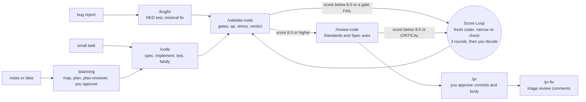

# claude-devkit

Spec-first development skills for [Claude Code](https://claude.ai/code). You start a skill, it does
one job, and it ends by *suggesting* the next one. Nothing is auto-routed, and no skill runs another.
Code is built against a test specification frozen before it, each test is proven by breaking the
code it covers, and gates plus an independent reviewer clear the result.

**Contents:** [Install](#install) · [First run](#your-first-run-5-minutes) · [How a change flows](#how-a-change-flows) · [Skills](#skills) · [Quality gates](#quality-gates) · [Score Loop](#the-score-loop) · [Hooks](#hooks) · [Headless driver](#headless-driver-opt-in) · [Configuration](#configuration) · [Troubleshooting](#troubleshooting) · [Reference](#reference)

## Install

One command per machine. It detects the OS, installs what is missing, puts the devkit in
`~/.claude`, and wires the hooks into `settings.json`. macOS, Linux and WSL.

```bash
git clone https://github.com/LuisFelipeMoro/Harness-devkit
cd Harness-devkit
bash install.sh
```

Re-running is the normal case; it does nothing expensive when the installed commit matches.

```bash
bash install.sh --check          # report only, never writes
bash install.sh --yes            # no prompts
bash install.sh --no-deps        # skip package installation
bash install.sh --no-claude-mem  # skip the claude-mem memory layer
bash install.sh --dry-run        # print what would happen
```

| Step | Detail |
|---|---|
| Source | The clone you ran it from, or `~/.local/share/claude-devkit`. Fast-forwards only; never touches a dirty or diverged tree. |
| Dependencies | Required: `git`, `python3`, `curl`. Recommended: `gh`, `shellcheck`, `ripgrep`. |
| Devkit files | Agents, skills, references and `CLAUDE.md` into `~/.claude`, plus git-hook templates. |
| Hook wiring | Merges the hook graph into `~/.claude/settings.json` and verifies every shipped hook is referenced. |
| claude-mem | Optional (`npx claude-mem install`, Node 20+). Never fails the run. |

It never pipes a downloaded script into a shell. Your own `~/.claude/` files are untouched:
`~/.claude/CLAUDE.md` gets one `@include` line, and `settings.json` keeps your `model`,
`permissions`, `env` and non-devkit hooks. Invalid JSON aborts rather than being rewritten.
The flat install also stages the sensor scripts (`scripts/verify/*`, `estimate-run.py`,
`harness-metrics.py`, `headless.py`, `drive.py`) to `~/.claude/devkit/scripts/`, where skills and
agents resolve `scripts/…` paths.

**As a Claude Code plugin instead:**

```
/plugin marketplace add LuisFelipeMoro/Harness-devkit
/plugin install coding-pipeline@claude-devkit
```

A plugin cannot ship a `CLAUDE.md` or write `.git/hooks/`. Add the standards with
`cp plugins/coding-pipeline/CLAUDE.md ~/.claude/devkit/CLAUDE.md` plus an `@~/.claude/devkit/CLAUDE.md`
line in `~/.claude/CLAUDE.md`, and the git hooks per repo with `bash ~/.claude/git-hooks/install.sh`.

**Codex CLI:** `bash plugins/coding-pipeline/scripts/install-codex.sh` places every skill in
`~/.agents/skills/`; `generate-codex-agents.sh` writes one `~/.codex/agents/<name>.toml` per agent.
Skill sequencing under Codex is not yet validated live; see `plugins/coding-pipeline/codex/harness-adapter.md`.

**Upgrading from 2.x** retires the old skills, agents and hook (`multi-agent`, `task`,
`analysis`, `architecture`, `quality-gate`, `code-review-gate`, `pr-review`, `checkcomments`, `bug-fix`;
`analyst`, `pm`, `scrum-master`, `orchestrator`, `tuner`, `architect`, `devops`;
the orchestrator Bash-guard hook and its `settings.json` entry). Each is moved to
`~/.claude/devkit/retired/<UTC timestamp>/`, never deleted, and only when its bytes match a version
the devkit shipped. A file of yours that shares one of these names is left in place and reported
`kept (not the devkit's): <path>`. Nothing else in `~/.claude/` is touched.

Install overrides: `DEVKIT_HOME` (managed clone location), `DEVKIT_REPO` (clone source),
`TARGET_HOME` or `--home DIR`.

## Your first run (5 minutes)

Open Claude Code in your repo and type `/devkit-help` to list every skill. Then take a feature
through the whole chain. Each step is a command you type; the skill asks before anything that matters.

```
/planning notes/webhooks.md
/code docs/plans/webhook-delivery/plan.md
/validate-code docs/plans/webhook-delivery/plan.md
/review-code
/pr
```

1. **`/planning`** maps the codebase, drafts the plan, **asks whether to grill it**, has `plan-reviewer` check it, then **asks you each open question** and **asks you to approve**. The plan lands in `docs/plans/{slug}/plan.md`. No code is written.
2. **`/code`** **asks for a run mode** (inline, one coder, one coder per row, or parallel when rows are independent), each with a token range. Each row is built, tested, then broken to prove the test fails, then format, lint and existing tests run.
3. **`/validate-code`** asks nothing. It runs every gate, then `qa` and `stress` at the depth the diff needs, fixes under the [Score Loop](#the-score-loop), and prints a verdict.
4. **`/review-code`** prints its findings, then **asks whether to post them**, in which language and style. Posted comments read like a person wrote them; severities, axes and the score stay in the terminal.
5. **`/pr`** **asks you to approve the commit list and the PR body** before anything is pushed.

Smaller jobs use the same chain with less ceremony:

```
/code "Reject negative quantities in AddToCart with ErrInvalidQuantity"
/validate-code
```

With no plan, `/code` writes a mini-plan (ACs, Test Case table, one Tasks row) and **asks for a
one-line OK** first. `/validate-code` prints the depth it measured from the diff (for a change this
size, typically `light`: `qa` only).

For a bug:

```
/bugfix "cart total goes negative after removing a coupon"
/validate-code
/review-code
/pr
```

`/bugfix` **asks for the symptom, a repro, the fix depth and the branch**. It shows ranked hypotheses
without waiting, then **asks you to confirm the root cause and fix** after the failing test is RED. The
fix turns it GREEN with every gate run. More task presets, each with what its plan should carry:
[`references/presets.md`](plugins/coding-pipeline/references/presets.md).

At the end of a session, `/retro` turns what went wrong into environment fixes. You can start at any
step: ceremony scales with the change; the standards do not.

## How a change flows



Two rules hold at every arrow. The implementer is not the validator: `coder` builds, and `qa`,
`reviewer` and `stress` cannot edit files. And the test specification is frozen before any code.

## Skills

Invoke by name. Each skill has `disable-model-invocation: true`, so Claude never starts one on its own.

| Skill | Use it when |
|---|---|
| `/planning [notes.md]` | You have a feature and want a reviewed plan in `docs/plans/{slug}/plan.md`. With a base file it normalizes your notes into the template. Writes no code. |
| `/code [plan.md or task text]` | You have an approved plan, or a small task. One `coder` dispatch per Tasks row: spec, implement, test, falsify, then format, lint and existing tests. |
| `/validate-code [--full]` | Code is written and you want the verdict: all gates and sensors, then `qa` and `stress` at the depth the diff needs. A score below 8.0 or a hard-gate FAIL runs the Score Loop: a fresh `coder` fix round and a narrow re-check, up to 3 rounds, then you decide. |
| `/review-code [PR# or branch]` | You want a second pair of eyes on a diff or PR. `reviewer` scores two separate axes, Standards (repo standards, devkit rules, code smells) and Spec (does it do what the plan or issue asked). A sensor detects the languages in the diff and the review prints one `Language` line per language. Asks whether to post, in which language and style (Short or With suggestions); posted comments carry no severity labels, emoji or tags. `--split` reviews each axis in its own dispatch. A score below 8.0 or a CRITICAL finding runs the Score Loop on a checked-out branch. |
| `/pr [base]` | The branch is ready: atomic conventional commits, push, and a PR (Summary · Evidence · Merge Danger), only after you approve the commits and the body. |
| `/pr-fix` | A PR has open comments: triages them into a table, you pick which to fix, `coder` fixes them, gates run, a `reviewer` pass scores the fix diff, and replies are drafted. Asks before posting or pushing. `--list` only lists. |
| `/bugfix` | Something is broken: `bug-investigator` builds a loop that goes red on the bug, ranks hypotheses, confirms the root cause and writes a RED test; `coder` makes the minimal fix. |
| `/map [area]` | You need to know an area before changing it: read-only map with blast radius, reusable symbols, prior art, conventions, each cited `file:line`. |
| `/deps` | Dependencies need an audit or upgrade: batches, majors separate, gates after each batch. |
| `/security-review` | You want an OWASP Web and LLM Top 10 audit with severity-tagged findings. |
| `/database-migration` | You need a schema change: additive, reversible, with a falsified test. |
| `/observability` | You are adding logs, metrics or tracing, with a falsified contract test. |
| `/performance-profiling` | Something is slow: trace-first latency and pprof investigation. |
| `/release-management` | You are cutting a release: semver bump, CHANGELOG, tag and a draft GitHub release from merged `main`. |
| `/improve-codebase-architecture` | You want an architecture health review in deep-module terms (depth, seams, leverage, locality). |
| `/business-analysis`, `/technical-analysis` | You need business rules or technical contracts of a domain mapped. |
| `/grill-me` | You want a plan or design stress-tested: every question that can be asked now, each with a recommended answer. |
| `/handoff` | The session is ending: handoff doc plus `PROGRESS.md` refresh. |
| `/retro [session] [--metrics]` | You want to improve the agent environment: severity-ordered fixes (pointers, checks, reviewer rules, CLAUDE.md, tool economy), applied only if you pick them. `--metrics` counts the five Harness health signals (`scripts/harness-metrics.py`): diagnostics, never gates. |
| `/rote`, `/rote-adapter` | Run existing rote flows; build a new adapter. |
| `/write-a-skill` | You want to scaffold a new skill. |
| `/devkit-help [skill \| flows]` | You are lost: lists every skill by job (read live from the installed `CLAUDE.md`), the typical flows, or one skill's usage and next step. No dispatch. |

### How `/code` runs

`/code` finds the plan (the path you pass, else an approved `docs/plans/*/plan.md`, else a mini-plan
it writes and you OK), then runs `scripts/estimate-run.py --plan <path>` and asks you to pick a mode:

| Mode | Fits | Dispatches |
|---|---|---|
| Inline | 1–2 small rows | none; your session codes |
| Single coder | tightly coupled rows, shared files (warns above 4 rows) | 1 |
| Sequential coders | most plans (default) | 1 per Tasks row, in dependency order |
| Parallel coders | rows with no `Depends on` and disjoint `Files` | 1 per row, ≤ 3 at once in worktrees, merged in row order with gates after each merge |

Each mode shows a token range labelled `measured`, `partly measured` or `assumed` by its weakest
input, plus the measured fix-round factors, and you can override the mode per row. Gates and
falsification evidence run in every mode.

### Which agents each skill dispatches

| Skill | Agents dispatched |
|---|---|
| `/planning` | 1 map (haiku) + 1 `plan-reviewer` per round; a score below 8.0 or `PLAN CHANGES REQUIRED` runs the Score Loop, max 3 fix rounds. Fix rounds are drafted in your session. |
| `/code` | per the mode you pick (above); `coder`, `coder-backend` or `coder-frontend` by the row's Tier |
| `/validate-code` | By the depth `scripts/verify/classify-diff.sh` measures: cosmetic (doc/style only) none · light (≤ 2 source files, no dependency change, no Stress trigger) `qa` · standard/full `qa` + `stress`. Depth only escalates: unmeasured is full, `--full` forces full. The verdict is `scripts/verify/verdict.sh` plus an inline self-check. Each Score Loop round adds one `coder` dispatch and a narrow `qa` and `stress` re-check, at most 3 rounds. |
| `/review-code` | 1 `reviewer` (2 in parallel with `--split`); each Score Loop round adds a `coder` dispatch and a narrow `reviewer` re-check, at most 3 rounds |
| `/pr-fix` | `coder` fixes the picked groups, then 1 `reviewer` scores the fix diff; each Score Loop round adds a `coder` and a narrow `reviewer` re-check, at most 3 rounds |
| `/bugfix` | `bug-investigator` + `coder` |

Agents receive file paths, never pasted contents, and **load on demand**: one language file up
front, every other reference only when its trigger fires. `plan-reviewer`, `qa`, `reviewer`,
`stress` and `bug-investigator` run on sonnet; `coder` and the map on haiku. The model aliases
resolve to the newest model in each family. These agents are registered only when the devkit is
installed, flat (`install.sh`) or as a plugin; in an uninstalled checkout a skill must dispatch a
`general-purpose` agent pointed at the agent file (`plugins/coding-pipeline/agents/<name>.md`).

## Quality gates

### What is enforced

- **Spec-first, falsification-proven.** The Test Case table is frozen before code. The coder writes
  exactly those tests, then breaks the code (`scripts/verify/break-run.sh`) to prove each one fails.
  Tautology is the blocking defect, not low coverage.
- **Plans are checked against the real repo.** Every plan carries a codebase map and a Reuse Map
  (`reuse:` / `extend:` / `new:`, cited `file:line`). `plan-reviewer` reads it with the repository open.
- **New files are justified.** Every new file names the closest existing file and why it cannot
  live there; `plan-reviewer` and `reviewer` flag a weak reason.
- **Go test files are paired.** `foo.go` is tested by `foo_test.go`; `checkpoint-m.sh` fails a new test
  file that breaks this.
- **Front-end work is tested for reach.** Rendered UI needs real-browser reflow, axe and keyboard rows,
  with WCAG 2.2 AA as the floor; `checkpoint-m.sh` fails a change that omits them or blocks zoom.
- **Implementer is not the validator.** `coder` builds; `qa`, `reviewer` and `stress` cannot edit files.
- **Duplication is measured and attributed.** `jscpd` gates at 3% *introduced*; pre-existing debt is
  reported, never blocking (`git-hooks/dup-attribution.py`).
- **Principal-engineer bar** in any language: correct, legible, durable, small. Every finding names
  the future change it makes harder.
- **Security first.** OWASP Web and LLM Top 10, secrets never read or written, parameterized queries only.
- **80% context ceiling.** The hook measures it; at 80% the session checkpoints to `PROGRESS.md`.
- **Language specialists.** Go, TypeScript, Java, PHP, Rust, React, Next.js, Flutter, HTMX, Kotlin and
  HTML/CSS, one file each in `references/languages/`, loaded one at a time.

Full rules: [`plugins/coding-pipeline/CLAUDE.md`](plugins/coding-pipeline/CLAUDE.md).
Branching: work on the current branch; on `main` a `feat/{slug}` branch is cut first; nothing is
pushed or opened as a PR unless you ask ([`references/branching.md`](plugins/coding-pipeline/references/branching.md)).

### The gates

Every number lives in [`references/thresholds.md`](plugins/coding-pipeline/references/thresholds.md); the commands per stack are in [`references/quality-gate-reference.md`](plugins/coding-pipeline/references/quality-gate-reference.md).

| Gate | Go | TypeScript | React | Flutter | Kotlin |
|------|-----|------|-------|---------|--------|
| Format | `gofmt` | `prettier --check` | `prettier --check` | `dart format` | `ktlint` |
| Lint | `go vet` + `golangci-lint` (0) | `eslint --max-warnings 0` | `eslint` (react-hooks + a11y) | `flutter analyze` | `detekt` + `ktlint` |
| Types | — | `tsc --noEmit` | `tsc --noEmit` | — | — |
| Coverage | ≥ 85% | ≥ 85% | ≥ 85% | ≥ 80% | ≥ 85% |
| Race | `go test -race` | — | — | — | — |
| Vuln | `govulncheck` | `npm audit` | `npm audit` | — | — |
| Modernize *(advisory)* | `go fix -diff` (Go ≥ 1.26, reports only) | — | — | — | — |
| Spec lint | `spectral lint` | `spectral lint` | — | — | — |

Coverage is a floor, never the goal. A green 85% made of tautologies fails the `qa` audit.

### The Score Loop

In plain words: a score below 8.0 is not an answer, it is a to-do list. Any scored validation (plan
review, `/validate-code`, `/review-code`, `/pr-fix`) whose overall score is below 8.0 goes back for
a fix round and a narrow re-check, until it reaches 8.0. Each round is a fresh `coder` that sees
only the findings. After 3 fix rounds you decide: fix the remaining gaps, accept with known issues,
or stop. Procedure: [`references/quality-gate-reference.md`](plugins/coding-pipeline/references/quality-gate-reference.md) § Score Loop.

| Result | Criteria |
|--------|---------|
| PRODUCTION READY | Overall 8.0 or higher, no CRITICAL security issues |
| READY WITH CONDITIONS | 6.5–7.9, or 8.0+ with 1 CRITICAL |
| NOT READY | below 6.5 or unmitigated CRITICAL security issue |

`/validate-code` weighs Stress 35% · QA 30%, renormalised (`verdict.sh --no-review`); at light depth
QA alone (`--no-stress`), at cosmetic depth gates only. `/review-code` is a separate gate: score ≥ 8.0
with no CRITICAL passes. The two never wait on each other.

### Spec-first, in four steps

Tests are written **after** the implementation, against a specification frozen **before** it.

1. **Spec**: the plan's Test Case table gives, for every AC, edge case and security control, one row with the literal test name, the input, the **expected observable result**, **why it matters**, and the **break that falsifies it**. A behaviour with no row does not get built.
2. **Implement**: `coder` builds to that table. Anything the spec didn't decide is flagged, never invented.
3. **Test**: it writes exactly those rows, no more, no fewer, asserting observable results.
4. **Falsify**: for each test it applies the row's break (invert the condition, delete the guard, return the zero value), confirms the test **fails on its own assertion**, and restores. A test never observed failing is unproven and does not ship.

`qa` does not write these tests; it audits them: every row implemented, valid falsification evidence
(it re-breaks the highest-risk ones), no tautological or over-mocked assertions, corner cases covered
(boundaries, nulls, overflow, unicode, concurrency, time, error paths), and no existing test weakened
to make a change pass. A tautological or unfalsified test is a MAJOR finding that caps the QA score
at 4, however high coverage is. Gaps go back to a fresh `coder` via `QA→CODER TEST GAP`. Prose-only
rows (Markdown) are marked `n/a — Markdown, wiring check` and get a wiring check instead of a break.

**The one exception is bug fixes**: a failing reproduction test is written and observed RED *before*
the fix, because that RED proves the root cause was found rather than guessed.

### The Harness behind it

| Component | What it is here |
|-----------|-----------------|
| **Guides** (feed-forward) | `CLAUDE.md`, the plan (`docs/plans/{slug}/plan.md`), API specs, per-language standards, injected before each task |
| **Sensors** (feedback) | Linters in error mode and test/coverage gates that return an exit code, not prose: `pre-commit` (format + lint), `pre-push` (tests + coverage 85%+ + vuln scan), mirrored in CI. Session guards run as Claude Code hooks (below). `checkpoint-m.sh` runs spec coverage, diff scope, stray commits, leftover break markers and duplication to completion and reports every failure at once; `break-run.sh` makes falsification evidence real: it mutates exactly one literal, runs the test, requires the row's own `FAIL: <row>` in the output, then restores the file on every exit path. |
| **Memory** | `PROGRESS.md` at the repo root (Done / Failed / Current State / Next / Lessons), entries prefixed with the plan slug. A `SessionStart` hook reads it so a new session resumes with context. Git-ignored: local session memory, never committed, and the same holds for the handoff docs `/handoff` writes. |
| **Separation** | **Implementer is not the validator**: `coder` builds, `qa`/`reviewer`/`stress` validate. ACs and the Test Case table are frozen before any code. Read-only subagents may fan out wider than writers (width in `thresholds.md`); writers stay at 3 or fewer per turn. Agent teams are documented, opt-in, and never enabled by the installer. |

### Engineering standards in brief

`CLAUDE.md` is injected into every Claude Code session. A few of its rules:

- **Go:** zero error discards (`_ =` on an error is a hard block); wrap errors with `fmt.Errorf("doing X: %w", err)`; `swaggo/swag` annotations on every HTTP handler; check for transaction races, not just data races; no `time.Sleep` in tests. Toolchain capabilities are detected, not versioned. Error handling, safety and service rules live in `references/go-error-handling.md`, `go-safety.md` and `go-services.md`, loaded only when the diff or plan touches their trigger. A golangci-lint v2 baseline is offered in `git-hooks/golangci.yml`, not enforced.
- **TypeScript:** `strict: true`; no `any` on public API or HTTP boundaries; zod/joi validation at every HTTP boundary.
- **React:** functional components and hooks only; `eslint-plugin-react-hooks` and `jsx-a11y` at zero violations; no `dangerouslySetInnerHTML` with user data (sanitize via `DOMPurify`).
- **Library API rule:** before writing library-specific code, Claude fetches current docs via context7, never from training data. If context7 has nothing, it falls back to the installed version's changelog.
- **Spec-driven HTTP work:** `api-spec.yaml` (OpenAPI 3.1) is written before code; the coder writes contract tests per `operationId` and annotations must reproduce the spec; `qa` runs Spectral lint and schema validation; `reviewer` checks drift. The spec is the source of truth.
- **Security:** OWASP Web Top 10 (2025) at review and verdict; OWASP LLM Top 10 2025 for AI/GenAI work; credential writes and destructive shell commands are blocked at hook level; never log PII, secrets, tokens or card data.

## Hooks

Session hooks run in Claude Code. They are deterministic (regex and exit codes, no model in the loop), each covered by `.github/scripts/test-hooks.sh`, and fail open on a payload they cannot parse.

| Hook | Trigger | Behaviour |
|------|---------|-----------|
| `session-bootstrap.sh` | SessionStart | Prints `PROGRESS.md` so a new session resumes with done/failed/current state; output is capped at 9,500 characters, dropping the oldest entries first |
| `env-guard.sh` | PreToolUse | Blocks reads of `.env`, `.envrc`, `.env.*`, including via `cat`/`grep` |
| `destructive-guard.sh` | PreToolUse(Bash) | Blocks force-push, remote branch deletion, `reset --hard` on a mainline, root/home recursive deletes, `curl \| sh`, `chmod 777`, destructive DDL |
| `gate-filter.sh` | PreToolUse(Bash) | Opt-in: set `DEVKIT_GATE_FILTER=1`. Rewrites a simple test/lint gate command (`go test`, `tsc`, `eslint`, `npm test`…) so only failure lines and a 20-line tail reach context; the full output stays in a file named on the last line. Opt-in because Claude Code cannot pre-check the rewritten compound command, so it needs a broad Bash allow (auto/bypass mode or the driver grant). Inert when `rtk` is on PATH |
| `secret-write-guard.sh` | PreToolUse(Write/Edit) | Blocks writing a recognisable live credential |
| `go-test-name-guard.sh` | PreToolUse(Write) | Blocks creating a `*_test.go` with no same-named source beside it (`bar_test.go` needs `bar.go`); existing files are not judged |
| `dispatch-budget.sh` | PreToolUse(Agent) | Warns once past the session dispatch budget (default 20, `DEVKIT_DISPATCH_BUDGET`); flags an oversized dispatch prompt |
| `session-tracker.sh` | PostToolUse | Records changed source files and whether a gate command ran |
| `context-budget.sh` | PostToolUse | Warns at 60% context, calls the 80% ceiling |
| `pr-review-responder.sh` | PostToolUse(Bash) | After `git push`, says how many PR comments are open and suggests `/pr-fix` |
| `precompact-snapshot.sh` | PreCompact | Records branch, dirty files and recent commits before compaction |
| `delivery-gate.sh` | Stop | Refuses to call a session done when source changed and no test, lint or type-check ran; suggests `/validate-code` |

`strict` profile blocks a given session only once: a Stop hook that blocks forever traps the operator
rather than the mistake. Turn hooks off or dial them under [Configuration](#configuration).

### Git hooks

| Hook | Runs | Checks |
|------|------|--------|
| `pre-commit` | Every commit | Go: `gofmt`, `go vet`, `golangci-lint run --fast-only` (v2; `--fast` on v1, no fast flag if the version is unreadable) · TS: `tsc --noEmit`, `eslint` |
| `pre-push` | Before push | Go: `go test -race`, coverage 85%+, `govulncheck` · TS: `jest --coverage`, `npm audit` · duplication |
| `commit-msg` | Every commit | Conventional Commits |

Both pre-commit and pre-push also run `release-content-guard.sh`: `PROGRESS.md`, handoff snapshots and
generated test output are rejected before they can enter a commit or push. Patterns come from the
repo's own `.devkit/release-exclude` (one glob per line). `PROGRESS.md` is local session state,
git-ignored, and stays out of releases.

`git-hooks/golangci.yml` is the offered golangci-lint v2 baseline. The flat install copies it to
`~/.claude/git-hooks/`, and no hook installer copies it into a repo. Adopt it per repo with
`cp ~/.claude/git-hooks/golangci.yml .golangci.yml`; pre-commit never passes `--config`, so a repo
without the file is unaffected.

## Headless driver (opt-in)

`scripts/drive.py` runs `/code`, `/validate-code` and `/review-code` for one approved plan, each stage
in a fresh `claude -p` session under a fixed permission grant, and records the run in `run-state.json`
(schema 2). The answers contract is in [`references/headless-runs.md`](plugins/coding-pipeline/references/headless-runs.md).

```
python3 ~/.claude/devkit/scripts/drive.py --plan docs/plans/{slug}/plan.md [--model sonnet] [--mode sequential] [--budget-usd 8] [--resume-from code|validate|review]
```

| Topic | Behaviour |
|---|---|
| Refuses to start | On main or master, on a detached HEAD, on a dirty tree, and on a plan whose Status is not `approved`. |
| Never | Pushes or opens a PR. The commit it makes stays on the feature branch. |
| Stops for a human | On anything but `PRODUCTION READY`: NOT READY, a condition, a block, the usage limit, a `NEEDS_USER:` question, an empty diff, or a rejected commit. |
| Deny list | It never commits a staged file named `.env`, `.env.*`, `.envrc`, `*.pem`, `*.key`, `id_rsa*` or `*.p12`: it unstages them and stops. `.env.example`, `.env.sample` and `.env.template` are the only exemptions. |
| Caps | Each stage is capped at `--budget-usd 8` and 3600 s. Score Loop fix rounds run inside the same stage session without a question, so a `/validate-code` or `/review-code` stage costs more than a single pass. |
| Lock | One run per plan: it takes `docs/plans/{slug}/run-state.lock` and a second run exits 2. A stale `run-state.json.*.tmp` from a killed write is removed under that lock. |
| Resume | `--resume-from` keeps earlier stages' records and reruns from the named stage. It refuses to resume past the code stage unless that stage is recorded and committed, refuses when the recorded code stage did not end `ok` or HEAD no longer descends from the recorded base, and refuses to resume at review without a validate record. |

## Configuration

All settings are environment variables. None is required.

| Variable | Effect |
|---|---|
| `DEVKIT_HOOK_PROFILE=off` | Every guard is inert |
| `DEVKIT_HOOK_PROFILE=standard` | Default. Guards block; `delivery-gate` warns |
| `DEVKIT_HOOK_PROFILE=strict` | `delivery-gate` blocks once per session instead of warning |
| `DEVKIT_DISABLED_HOOKS=id,id` | Disables individual hooks: `pre:read:env-guard`, `pre:bash:destructive-guard`, `pre:bash:gate-filter`, `pre:write:secret-guard`, `pre:write:go-test-name`, `post:session-tracker`, `stop:delivery-gate` |
| `DEVKIT_GATE_FILTER=1` | Turns on `gate-filter.sh` (off by default) |
| `DEVKIT_GATE_RE` | Regex of commands `gate-filter.sh` and `session-tracker.sh` treat as a gate; the default covers `go test`, `tsc`, `eslint`, `npm test`, `pytest`, `cargo test` and more (`hooks/hook-lib.sh`) |
| `DEVKIT_DISPATCH_BUDGET` | Subagent dispatches per session before the one-time warning. Default 20 |
| `DEVKIT_PROMPT_MAX_CHARS`, `DEVKIT_PROMPT_MAX_FILES` | Size at which a dispatch prompt is flagged as oversized. Defaults 6000 characters, 8 files |
| `DEVKIT_CONTEXT_WINDOW` | Context window size in tokens, when the hook cannot infer it from the model id |
| `DEVKIT_CONTEXT_WARN`, `DEVKIT_CONTEXT_CEILING` | Context fractions for the warning and the ceiling. Defaults 0.60 and 0.80 |
| `DEVKIT_DUP_MAX` | Duplication percentage `dup-gate.sh` allows to be introduced. Default 3 |
| `DEVKIT_HOME`, `DEVKIT_REPO` | Install only: where the managed clone lives and where it is cloned from |

Hook and gate numbers are single-sourced in [`references/thresholds.md`](plugins/coding-pipeline/references/thresholds.md).

## Troubleshooting

**A hook blocked my command.** Read the message: it names the rule. To turn one hook off, add its id to `DEVKIT_DISABLED_HOOKS`; to turn all guards off for a session, set `DEVKIT_HOOK_PROFILE=off`.

**Claude refuses to read a `.env` file.** That is `env-guard.sh`, by design. Never put secrets where an agent has to read them; pass what it needs another way.

**Claude says it cannot call `reviewer`, `qa` or `coder`.** Those agents exist only when the devkit is installed. Run `bash install.sh --check` to see what is missing, or in an uninstalled checkout dispatch a `general-purpose` agent pointed at `plugins/coding-pipeline/agents/<name>.md`.

**The session ended with a "run a gate" warning.** `delivery-gate.sh` saw changed source and no test, lint or type-check. Run `/validate-code`, or any gate command. Under `strict` it blocks once per session.

**`gate-filter.sh` does nothing.** It is opt-in (`DEVKIT_GATE_FILTER=1`) and inert when `rtk` is on PATH. It also needs a broad Bash allow.

**Every Go commit is rejected by pre-commit.** On golangci-lint v2 the old `--fast` flag exits 3. This devkit's hook uses `--fast-only` on v2; reinstall the git hooks with `bash ~/.claude/git-hooks/install.sh`.

**`drive.py` exits 2 straight away.** Another run holds `docs/plans/{slug}/run-state.lock`. Wait for it, or check that no `drive.py` process is still alive.

**`drive.py` stopped and will not resume.** Resume past the code stage needs that stage recorded as `ok` and committed, and HEAD must still descend from the recorded base. Fix the cause or rerun from `--resume-from code`.

**A commit was rejected for `PROGRESS.md`.** `release-content-guard.sh` keeps session files out of commits. They are local by design; the patterns are in `.devkit/release-exclude`.

**The context warning keeps appearing.** At 60% completed work should be compacted to short references; at 80% the session checkpoints to `PROGRESS.md` and continues. See [`references/context-budget.md`](plugins/coding-pipeline/references/context-budget.md).

## Companion tools (optional)

| Tool | Install | What it adds |
|------|---------|--------------|
| **RTK** | Internal / see [RTK repo](https://github.com/JuliusBrussee/rtk) | Filters CLI output (`git`, `go test`, `tsc`, `eslint`, …) to failures and errors, wired through a `PreToolUse` hook; 60–90% fewer tokens on command output |
| **Caveman** | `claude plugin install caveman@caveman` | Compressed responses (`/caveman lite\|full\|ultra`); code and security warnings stay fully expanded |
| **Rote** | Internal / see rote repo | Adapter framework: `/rote` runs existing flows, `/rote-adapter` builds a new integration, and a successful call is crystallized as a reusable CLI flow |
| **context7** | `claude plugin install context7@claude-plugins-official` | Live library docs, fetched before any library-specific code is written |
| **claude-mem** | `npx claude-mem install` (or `bash install.sh`) | Compresses and replays prior sessions, so context survives a restart |

### Tools the gates call

| Tool | Install | Used by |
|------|---------|---------|
| `gh` (GitHub CLI) | `brew install gh` / `apt install gh` | PR hook, `/review-code`, `/pr-fix`, release management |
| `golangci-lint` | `go install github.com/golangci/golangci-lint/cmd/golangci-lint@latest` | Go quality gates |
| `govulncheck` | `go install golang.org/x/vuln/cmd/govulncheck@latest` | Go vulnerability scan |
| `staticcheck` | `go install honnef.co/go/tools/cmd/staticcheck@latest` | Go static analysis |
| `swag` | `go install github.com/swaggo/swag/cmd/swag@latest` | Go OpenAPI generation |
| `spectral` | `npm i -g @stoplight/spectral-cli` | OpenAPI spec linting (all stacks) |
| `swagger-cli` | `npm i -g @apidevtools/swagger-cli` | OpenAPI spec validation |
| `schemathesis` | `pip install schemathesis` | Contract testing (integration phase) |
| `oapi-codegen` | `go install github.com/oapi-codegen/oapi-codegen/v2/cmd/oapi-codegen@latest` | Go: types and stubs from a spec |

## Reference

- [`CHANGELOG.md`](CHANGELOG.md): what each release ships.
- [`plugins/coding-pipeline/CLAUDE.md`](plugins/coding-pipeline/CLAUDE.md): the engineering standards, in full.
- [`references/thresholds.md`](plugins/coding-pipeline/references/thresholds.md): every numeric gate.
- [`references/quality-gate-reference.md`](plugins/coding-pipeline/references/quality-gate-reference.md): gate commands and the Score Loop procedure.
- [`references/headless-runs.md`](plugins/coding-pipeline/references/headless-runs.md): the headless answers contract.
- [`references/presets.md`](plugins/coding-pipeline/references/presets.md): task presets.
- [`references/branching.md`](plugins/coding-pipeline/references/branching.md): branch rules.
- [`references/languages/`](plugins/coding-pipeline/references/languages): one rules file per language.

The repo holds four plugins:

```
plugins/
├── coding-pipeline/   # planning, code, validate, bugfix, map; agents, hooks, references
├── engineering/       # deps, security-review, database-migration, observability,
│                      #   performance-profiling, release-management
├── pr-workflow/       # review-code, pr, pr-fix
└── devtools/          # improve-codebase-architecture, business/technical analysis,
                       #   grill-me, handoff, retro, write-a-skill, rote, rote-adapter,
                       #   devkit-help
```

### Developing the devkit

CI fails on an exit code, never on prose. Run the same checks locally:

```bash
bash .github/scripts/test-hooks.sh
bash .github/scripts/test-git-hooks.sh
bash .github/scripts/test-install.sh
bash .github/scripts/test-verify.sh
bash .github/scripts/test-dup-attribution.sh
python3 .github/scripts/validate-wiring.py   # manifests, hooks, links, skills table, 60-line skills
```

`validate-wiring.py` exists because nearly every capability is one file pointing at another, and
nothing executes those links at authoring time. It also enforces that every skill is manual, at most
60 lines, and never invokes another skill.
